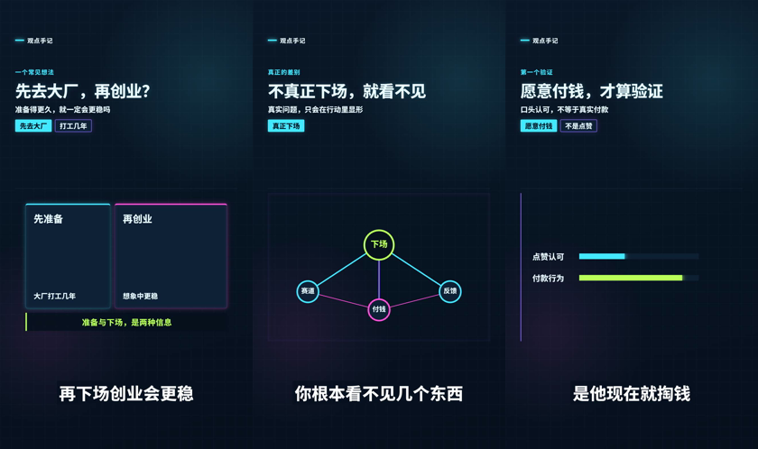
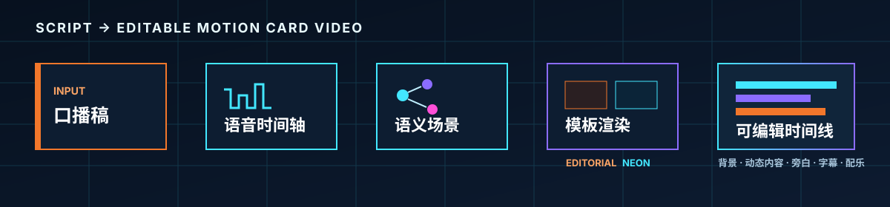

<div align="center">

# script-to-card-video

### 把一段口播稿，变成可编辑的竖屏动态卡片视频。

**A Codex Skill that turns narration scripts into editable 9:16 motion-card videos.**

[](SKILL.md)
[](#两套模板)
[](#已知边界)
[](LICENSE)


</div>

你给 Codex 一段口播稿或已经录好的旁白，这个 Skill 会把内容拆成有节奏的语义场景，并生成：

- 跟随语音依次出现的标题、关键词与解释文字；
- 与观点对应的编辑插画，或霓虹图表、连线和对比组件；
- 可继续修改的背景、动态内容、旁白、字幕与配乐图层；
- 适合短视频平台的 1080×1920 竖屏画面。

它不是把几张 PPT 生硬轮播，也不会默认把成品压成不可修改的视频。目标是：**用更低的制作成本，保留专业短视频需要的节奏、信息密度和可编辑性。**

> 当前版本面向中文口播工作流，提供两套经过真实 15 秒样片验证的结构模板。

## 效果预览

### `editorial-illustrated` · 编辑纸感

暖色纸张、编辑排版、递进关键词，以及每个场景一张语义明确的手绘矢量插画。


适合无需本人出镜的观点表达、个人故事、知识分享与商业思考短视频。

### `neon-infographic` · 霓虹信息图

深色科技背景、动态文字，以及图表、节点网络、指标、对比和步骤流程组件。它不生成人物插画，而是让信息关系本身成为视觉。



适合 AI、产品、商业、数据、流程、工具教程与技术内容。

上面的图片均来自实际可编辑时间线的验收帧，不是概念效果图；每组展示的是同一段口播中连续切换的三个不同场景。两套模板都默认生成全屏卡片视频，不展示真人画面。

## 30 秒开始使用

### 1. 准备环境

你需要：

- 已安装 Codex；
- 已连接 ChatCut 插件，用于创建和验证可编辑视频时间线；
- Python 3，用于运行 Codex 自带的 Skill 安装脚本。

ChatCut 只出现在运行依赖中，不属于 Skill 的公开名称。

### 2. 安装

让 Codex 帮你安装：

```text
Install the skill from https://github.com/kaomei/script-to-card-video
```

也可以直接运行：

```bash
python3 ~/.codex/skills/.system/skill-installer/scripts/install-skill-from-github.py \
  --repo kaomei/script-to-card-video \
  --path . \
  --name script-to-card-video
```

安装后重新开启一个 Codex 任务，让新 Skill 生效。

### 3. 粘贴口播稿

```text
Use $script-to-card-video to turn the following Chinese script into an
editorial-illustrated 9:16 card video with captions and gentle music:

很多人觉得先去大厂打工几年，再下场创业会更稳。
但因为你不真正下场，你根本看不见几个东西……
```

想使用科技风，只需把模板换成：

```text
Use $script-to-card-video with the neon-infographic template.
```

如果你没有指定模板，Skill 会先让你选择；明确交给 Codex 决定时，默认使用 `editorial-illustrated`。

## 两套模板

| | `editorial-illustrated` | `neon-infographic` |
| --- | --- | --- |
| 视觉语言 | 暖色纸张、编辑排版、橙色强调 | 深色科技、青紫霓虹、克制光晕 |
| 主要视觉 | 语义手绘矢量插画 | 图表、节点、指标、对比、流程 |
| 文字结构 | 标题 + 2–3 个递进关键词 | 标题 + 解释 + 2–3 个递进关键词 |
| 适合内容 | 观点、故事、知识、商业思考 | AI、产品、商业、数据、教程 |
| 插画策略 | 每个场景一个矢量语义图形 | 不生成角色或人物插画 |
| 动效节奏 | 关键词递进，插画描边后成形 | 关键词递进，信息组件按关系激活 |

这不是“同一套排版换两个颜色”。两个模板拥有独立的内容结构、视觉组件和渲染文件。

## 输入与输出

### 可以提供

- 一段中文口播稿；
- 已录制的旁白音频，或仅用于提取旁白声音的真人口播视频；
- 指定模板；
- 是否需要配乐；
- 品牌颜色、栏目名等可选信息。

如果提供真人口播视频，最终画面仍是全屏卡片，人物不会出现在成片中。

### 得到的可编辑图层

| 图层 | 作用 |
| --- | --- |
| Background | 固定背景与基础氛围 |
| Motion content | 标题、关键词、插画或信息图组件 |
| Narration | 用户旁白或生成的 TTS |
| Captions | 跟随真实语音时间轴的短句字幕 |
| Music | 可选的低音量背景音乐 |

字幕默认使用白字、直角半透明深色底，并保留在独立的原生字幕层中。

## 工作原理



1. **读取口播与音频**：优先使用你提供的录音；没有录音时才生成 TTS。
2. **获得真实时间轴**：通过转录获取语音时间，不凭空估算字幕时间。
3. **拆分语义场景**：按照观点推进，而不是机械地每句话切一页。
4. **选择视觉模块**：编辑模板选择语义插画；霓虹模板按信息任务选择图表、网络、对比或流程。
5. **验证场景计划**：检查场景连续性、关键词时间、模板字段与数据真实性。
6. **编译动态素材**：生成独立、可编辑的背景和内容 Motion Graphic。
7. **装配并验收**：放置旁白、字幕和可选配乐，检查切换边界与画面稳定帧。

默认停在可编辑项目，方便你先预览和修改；只有你明确提出时，才进入导出流程。

## 霓虹信息图组件

`neon-infographic` 会根据口播内容的“信息任务”选择组件，而不是随意装饰：

| 内容关系 | 组件 |
| --- | --- |
| 一个核心指标或状态 | `metric-stack` |
| 客户、渠道、资源或原因之间的关系 | `node-network` |
| 差距、方向或趋势 | `bar-trend` |
| 两种观点、状态或行为 | `split-comparison` |
| 方法、步骤或因果顺序 | `step-flow` |

只有原文或用户提供了数字时，画面才会显示数字。相对长度可以表达强调关系，但不会虚构百分比。

## 自定义

在不修改渲染器的情况下，可以调整：

- 标题、解释文字和关键词；
- 主色、强调色与文字颜色；
- 场景时长和关键词出现时间；
- 霓虹图表中的标签、节点与步骤；
- 字幕样式和位置；
- 是否使用配乐及配乐音量。

需要进一步扩展时，可以阅读：

- [Skill 完整工作流](SKILL.md)
- [场景计划 Schema](references/scene-schema.md)
- [两套视觉系统](references/visual-system.md)
- [贡献指南](CONTRIBUTING.md)

## 项目结构

```text
script-to-card-video/
├── SKILL.md
├── agents/
│   └── openai.yaml
├── assets/
│   ├── editorial-background-template.jsx
│   ├── editorial-content-template.jsx
│   ├── neon-background-template.jsx
│   └── neon-content-template.jsx
├── references/
│   ├── scene-schema.md
│   └── visual-system.md
├── scripts/
│   ├── build-motion-graphic.mjs
│   ├── validate-scene-plan.mjs
│   └── tests/
└── docs/assets/
```

四个 JSX 文件将两套视觉结构完全隔离；场景验证和编译入口则保持共享。

## 本地验证

```bash
node --test scripts/tests/*.test.mjs
```

```bash
python3 ~/.codex/skills/.system/skill-creator/scripts/quick_validate.py .
```

测试覆盖：

- 两套模板的场景计划与迁移规则；
- 场景连续性、关键词时间和数据字段；
- 四个 Motion Graphic 的编译与安全约束；
- 公开 Skill 契约；
- README 图片、链接、社区文件和许可证。

## 已知边界

- 当前公开模板只有 `editorial-illustrated` 和 `neon-infographic`。
- 默认画布为 1080×1920、30fps。
- 场景通常为 3.5–5.5 秒，最终状态至少保留约 0.8 秒。
- 当前工作流依赖 ChatCut 插件创建可编辑时间线。
- 不生成 PPT 或 PPTX。
- 不默认自动导出 MP4。
- 不会把没有数字的观点伪装成精确数据。
- 输出质量仍取决于口播逻辑、录音质量和语义拆分是否清晰。

## Roadmap

- 增加更多经过真实样片验证的信息图模块；
- 提供不同类型口播稿的完整示例；
- 优化安装、示例素材和发布包体积；
- 补充可复用的品牌色与栏目配置方式；
- 在保持可编辑性的前提下改善长口播的自动场景规划。

Roadmap 只记录方向，不承诺具体发布时间。新模板只有在拥有明确结构差异、真实视觉证明和完整测试后才会加入。

## Contributing

欢迎提交新的信息图模块、场景规则、示例和文档改进。涉及渲染器的修改需要同时提供：

- 自动化测试结果；
- 修改前后的真实画面；
- 对场景边界、字幕安全区和数据真实性的说明。

开始前请阅读 [CONTRIBUTING.md](CONTRIBUTING.md)。

## License

本项目使用 [MIT License](LICENSE)。

---

<div align="center">

**如果它帮你少做了一次重复剪辑，欢迎点个 Star。**

</div>
